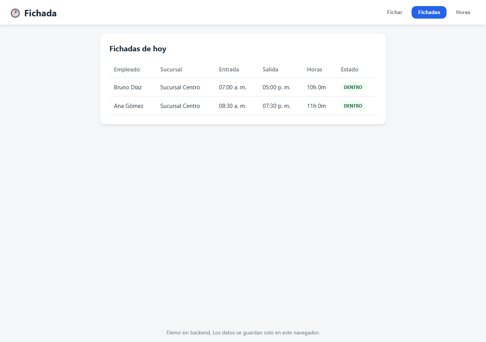

# 🕐 Fichada

[](https://github.com/lucabaello1998/fichada/releases/latest)

Demo de fichaje laboral (clock in/out) para una pyme argentina.

> **Este es un producto standalone de demostración.** No es el sistema de ninguna empresa real, no contiene datos reales ni está vinculado a ningún ERP.

El empleado ficha entrada y salida desde el celular u ordenador. Si el navegador entrega ubicación, la app calcula la distancia al perímetro de la sucursal con la fórmula de haversine (sin librerías externas) y avisa si está fuera del radio, pero permite fichar igual marcando la novedad. El encargado puede ver las fichadas del día y las horas trabajadas por persona y sucursal.



## Stack

- React 19 + Vite + TypeScript
- Sin backend: persistencia en `localStorage`
- Modo demo con 2 sucursales y 3 empleados ficticios
- Tests de reglas de negocio con Vitest
- CI con GitHub Actions (Node 20 y 22)
- Deploy automático en GitHub Pages

## Demostración sin GPS

La pantalla de fichar tiene un selector **Ubicación para la demo** (*mi GPS real*, *dentro de la
sucursal*, *a 60 m del límite*, *a 1,5 km*): permite ver los tres casos sin estar parado en una de las
sucursales ficticias ni dar permiso de ubicación.

## Cómo correrlo

```bash
npm install
npm run dev     # http://localhost:5173/fichada/
npm test        # Vitest
npm run build   # producción en dist/
```

## Reglas implementadas

- Una entrada abierta impide registrar otra entrada.
- No se puede registrar una salida sin una entrada previa.
- El cálculo de horas soporta cruces de medianoche.
- Las horas extra se calculan por día, por encima de 8 horas.
- La geolocalización es opcional: si el navegador no la entrega, se fich igual.
- Si la ubicación está fuera del perímetro de la sucursal, se marca la novedad pero se permite fichar.

## Límites

- Es una demo sin backend: los datos viven solo en el navegador.
- El GPS del navegador es aproximado y se puede falsear fácilmente, por lo que **no sirve como control de asistencia real**.
- No hay autenticación ni permisos: cualquiera con acceso al navegador puede modificar las fichadas locales.

## Deploy

El proyecto se publica automáticamente en GitHub Pages al hacer push a `main`. La URL pública es:

```
https://lucabaello1998.github.io/fichada/
```

El `base` de Vite está configurado como `/fichada/` para que los assets carguen correctamente.

## Licencia

MIT. Ver [LICENSE](LICENSE).
